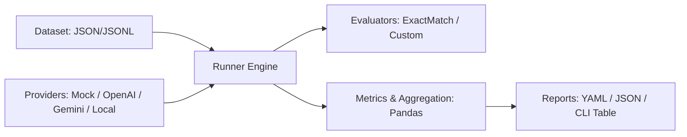

# Exetasiz

A lightweight, modular, and extensible framework for systematically testing, evaluating, and comparing Large Language Models (LLMs) on identical datasets.

## Architecture

Exetasiz follows a clean pipeline architecture using the adapter pattern:



## Quick Start

### Installation

```bash
git clone https://github.com/example/exetasiz.git
cd exetasiz
pip install -e .
```

Or install dependencies with `requirements.txt`:
```bash
pip install -r requirements.txt
```

### Running the Demo Experiment

Exetasiz runs completely offline with its deterministic `MockProvider`:

```bash
exetasiz run experiments/basic_qa_demo.yaml
```

Output:
```
Starting experiment 'basic_qa_demo'
Dataset: sample_qa (10 test cases)
Models: mock-perfect, mock-flawed
Evaluators: exact_match
---
Evaluating models [####################################] 100%

Experiment Run Complete!

╭──────────────┬─────────────┬──────────┬───────────┬──────────────┬────────────────┬────────────────┬────────────────────┬─────────────────────╮
│ model        │   total_... │   acc... │   pass... │   failure... │   avg_laten... │   p95_laten... │   total_input_t... │   total_output_t... │
├──────────────┼─────────────┼──────────┼───────────┼──────────────┼────────────────┼────────────────┼────────────────────┼─────────────────────┤
│ mock-flawed  │          10 │      0.5 │       0.5 │            0 │         0.0104 │         0.0109 │                100 │                  50 │
│ mock-perfect │          10 │      1.0 │       1.0 │            0 │         0.0105 │         0.0108 │                100 │                  50 │
╰──────────────┴─────────────┴──────────┴───────────┴──────────────┴────────────────┴────────────────┴────────────────────┴─────────────────────╯

✓ Artifacts saved to: reports/basic_qa_demo_...
```

### Auto-Generating Standalone HTML Reports

Generate a rich, standalone single-file HTML report upon experiment completion with `--report`:

```bash
exetasiz run experiments/basic_qa_demo.yaml --report
```

Or generate on-demand from any saved run folder:
```bash
# Generate report for the newest run and open in browser
exetasiz report latest --open

# Generate report for a specific run directory
exetasiz report reports/basic_qa_demo_2026-10-07T22-18-19-537259+00-00

# Custom output file and title
exetasiz report latest --output my_report.html --title "Sprint Benchmark"
```

### Listing Saved Evaluation Runs

```bash
exetasiz list-runs
```

Output:
```
run_directory                                   experiment     finished_at          models                     accuracy
----------------------------------------------  -------------  -------------------  -------------------------  ----------
basic_qa_demo_2026-10-07T22-18-19-537259+00-00  basic_qa_demo  2026-10-07 22:18:19  mock-perfect, mock-flawed  75.0%
```

---

## Reports & Result Persistence

Every evaluation run atomically writes structured artifacts to `reports/<experiment>_<timestamp>/`:

```
reports/<experiment>_<timestamp>/
├── config.yaml      # Snapshot of experiment configuration
├── results.json     # Results envelope (schema_version, metadata, and all EvalResult records)
├── metrics.json     # Hierarchical metrics (overall, by_model, by_category, by_model_and_category)
└── report.html      # Standalone single-file HTML report (generated on demand or via --report)
```

### Results Schema (`results.json`)

The top-level envelope contains:
- `schema_version`: String version (e.g. `"1.0"`).
- `run_id`: Unique identifier for the run.
- `experiment_name`: Name of the experiment from configuration.
- `started_at` / `finished_at`: ISO 8601 UTC timestamps.
- `duration_seconds`: Total runtime in seconds.
- `dataset`: Metadata object (`name`, `path`, `num_test_cases`).
- `models`: List of evaluated model names.
- `evaluators`: List of evaluator names used.
- `exetasiz_version`: Installed Exetasiz version.
- `results`: Complete list of individual `EvalResult` objects.

#### Schema Version Policy
- The `schema_version` is currently `"1.0"`.
- It will be incremented on any breaking schema change to `results.json` or `metrics.json`.
- `load_run()` validates compatibility and raises `UnsupportedSchemaVersionError` on mismatched versions.

### HTML Report Highlights

The generated `report.html` is **100% self-contained**:
- **Offline & Portable**: Zero CDN dependencies, zero external fonts, zero external images.
- **Pure-Python Inline SVG**: Dynamic bar charts for accuracy, latency (Avg vs p95), and grouped category breakdown.
- **Client-Side Vanilla JS**: Click-to-sort columns on the model comparison table and real-time interactive search/filtering in the Failures Explorer.
- **Security-Hardened**: All model outputs and prompts are HTML-escaped with strict Jinja2 autoescaping to prevent XSS.
- **Dark Mode & Print Support**: Adapts automatically to system light/dark appearance and provides a print stylesheet.
- A pre-rendered sample report is available at [`examples/sample_report.html`](examples/sample_report.html).

### Category-Level Breakdown

To view metrics grouped by category:
```bash
exetasiz run experiments/basic_qa_demo.yaml --by-category
```

### Validating Datasets

```bash
exetasiz validate-dataset datasets/sample_qa.json
```

### Listing Registered Providers & Evaluators

```bash
exetasiz list-providers
exetasiz list-evaluators
```

---

## Adding a New Provider

Inherit from `LLMProvider` and implement `_generate_internal`:

```python
from exetasiz.providers.base import LLMProvider, ProviderResponse
from exetasiz.providers.registry import register_provider

class AnthropicProvider(LLMProvider):
    def __init__(self, model: str = "claude-3-5-sonnet-20241022", name: str = None, **kwargs):
        super().__init__(name=name or f"anthropic:{model}")
        self.model = model

    def _generate_internal(self, prompt: str) -> ProviderResponse:
        import anthropic  # Lazy import
        client = anthropic.Anthropic()
        message = client.messages.create(
            model=self.model,
            max_tokens=1024,
            messages=[{"role": "user", "content": prompt}],
        )
        return ProviderResponse(
            text=message.content[0].text,
            input_tokens=message.usage.input_tokens,
            output_tokens=message.usage.output_tokens,
        )

# Register the provider
register_provider("anthropic", AnthropicProvider)
```

You can now use `provider: anthropic` in any experiment YAML file!

---

## Adding a New Evaluator

Inherit from `Evaluator` and implement `evaluate`:

```python
from exetasiz.evaluators.base import Evaluator, EvaluatorOutput
from exetasiz.evaluators.registry import register_evaluator
from exetasiz.core.models import TestCase

class ContainsKeywordEvaluator(Evaluator):
    def __init__(self, name: str = "contains_keyword", **kwargs):
        super().__init__(name=name)

    def evaluate(self, test_case: TestCase, generated_answer: str) -> EvaluatorOutput:
        passed = test_case.expected_answer.lower() in generated_answer.lower()
        return EvaluatorOutput(
            score=1.0 if passed else 0.0,
            passed=passed,
            details={"contains": test_case.expected_answer},
        )

# Register the evaluator
register_evaluator("contains_keyword", ContainsKeywordEvaluator)
```

---

## Roadmap

Exetasiz V1 establishes the clean modular core engine. Future phases include:

- **Semantic Similarity Evaluator**: Cosine similarity using Hugging Face / Sentence-Transformers embeddings.
- **LLM-as-a-Judge**: Multi-aspect grading (faithfulness, clarity, correctness) using configurable judge prompts.
- **Hallucination Detection**: Automated verification against provided retrieval context.
- **Toxicity & Safety Evaluator**: Moderation classification and toxicity score tracking.
- **Cost Tracking**: Automated real-time USD cost estimation using provider token pricing catalogs.
- **Asynchronous Execution & Concurrency**: High-throughput async batch runners with rate limit backoff.
- **Interactive Web Dashboard**: Streamlit / web report viewer for visual comparative analysis.
- **CI/CD Integration**: GitHub Actions workflow to run regression evals on every PR.
