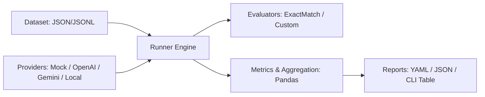

# Exetasiz

A lightweight, modular, and extensible framework for systematically testing, evaluating, and comparing Large Language Models (LLMs) on identical datasets.

## Architecture

Exetasiz follows a clean pipeline architecture using the adapter pattern:



## Quick Start

### Installation

```bash
git clone https://github.com/example/exetasiz.git
cd exetasiz
pip install -e .
```

Or install dependencies with `requirements.txt`:
```bash
pip install -r requirements.txt
```

### Running the Demo Experiment

Exetasiz runs completely offline with its deterministic `MockProvider`:

```bash
exetasiz run experiments/basic_qa_demo.yaml
```

Output:
```
Starting experiment 'basic_qa_demo'
Dataset: sample_qa (10 test cases)
Models: mock-perfect, mock-flawed
Evaluators: exact_match
---
Evaluating models [####################################] 100%

Experiment Run Complete!

╭──────────────┬─────────────┬──────────┬───────────┬──────────────┬────────────────┬────────────────┬────────────────────┬─────────────────────╮
│ model        │   total_... │   acc... │   pass... │   failure... │   avg_laten... │   p95_laten... │   total_input_t... │   total_output_t... │
├──────────────┼─────────────┼──────────┼───────────┼──────────────┼────────────────┼────────────────┼────────────────────┼─────────────────────┤
│ mock-flawed  │          10 │      0.5 │       0.5 │            0 │         0.0104 │         0.0109 │                100 │                  50 │
│ mock-perfect │          10 │      1.0 │       1.0 │            0 │         0.0105 │         0.0108 │                100 │                  50 │
╰──────────────┴─────────────┴──────────┴───────────┴──────────────┴────────────────┴────────────────┴────────────────────┴─────────────────────╯

✓ Artifacts saved to: reports/basic_qa_demo_...
```

Artifacts produced:
- `reports/<run_id>/config.yaml`: Configuration snapshot
- `reports/<run_id>/results.json`: Complete individual test evaluations and answers
- `reports/<run_id>/metrics.json`: Aggregated statistics

### Category-Level Breakdown

To view metrics grouped by category:
```bash
exetasiz run experiments/basic_qa_demo.yaml --by-category
```

### Validating Datasets

```bash
exetasiz validate-dataset datasets/sample_qa.json
```

### Listing Registered Providers & Evaluators

```bash
exetasiz list-providers
exetasiz list-evaluators
```

---

## Adding a New Provider

Inherit from `LLMProvider` and implement `_generate_internal`:

```python
from exetasiz.providers.base import LLMProvider, ProviderResponse
from exetasiz.providers.registry import register_provider

class AnthropicProvider(LLMProvider):
    def __init__(self, model: str = "claude-3-5-sonnet-20241022", name: str = None, **kwargs):
        super().__init__(name=name or f"anthropic:{model}")
        self.model = model

    def _generate_internal(self, prompt: str) -> ProviderResponse:
        import anthropic  # Lazy import
        client = anthropic.Anthropic()
        message = client.messages.create(
            model=self.model,
            max_tokens=1024,
            messages=[{"role": "user", "content": prompt}],
        )
        return ProviderResponse(
            text=message.content[0].text,
            input_tokens=message.usage.input_tokens,
            output_tokens=message.usage.output_tokens,
        )

# Register the provider
register_provider("anthropic", AnthropicProvider)
```

You can now use `provider: anthropic` in any experiment YAML file!

---

## Adding a New Evaluator

Inherit from `Evaluator` and implement `evaluate`:

```python
from exetasiz.evaluators.base import Evaluator, EvaluatorOutput
from exetasiz.evaluators.registry import register_evaluator
from exetasiz.core.models import TestCase

class ContainsKeywordEvaluator(Evaluator):
    def __init__(self, name: str = "contains_keyword", **kwargs):
        super().__init__(name=name)

    def evaluate(self, test_case: TestCase, generated_answer: str) -> EvaluatorOutput:
        passed = test_case.expected_answer.lower() in generated_answer.lower()
        return EvaluatorOutput(
            score=1.0 if passed else 0.0,
            passed=passed,
            details={"contains": test_case.expected_answer},
        )

# Register the evaluator
register_evaluator("contains_keyword", ContainsKeywordEvaluator)
```

---

## Roadmap

Exetasiz V1 establishes the clean modular core engine. Future phases include:

- **Semantic Similarity Evaluator**: Cosine similarity using Hugging Face / Sentence-Transformers embeddings.
- **LLM-as-a-Judge**: Multi-aspect grading (faithfulness, clarity, correctness) using configurable judge prompts.
- **Hallucination Detection**: Automated verification against provided retrieval context.
- **Toxicity & Safety Evaluator**: Moderation classification and toxicity score tracking.
- **Cost Tracking**: Automated real-time USD cost estimation using provider token pricing catalogs.
- **Asynchronous Execution & Concurrency**: High-throughput async batch runners with rate limit backoff.
- **Interactive Web Dashboard**: Streamlit / web report viewer for visual comparative analysis.
- **CI/CD Integration**: GitHub Actions workflow to run regression evals on every PR.
